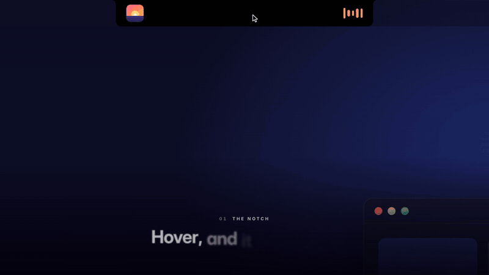

# AI Notch

AI Notch turns the notch on your MacBook into something useful. Hover over it (or click it) and it opens into a little panel with your music, your calendar, widgets and a spot to drop files. It can also be an AI assistant that runs on your own computer, so nothing you ask it goes to a big company's servers.

**[Watch the full 1-minute video](media/AI-Notch.mp4)**

This repo is just for downloads. Grab the latest version from the [Releases](../../releases) page.

## What it does

**The notch**
- Music controls with album art, for Apple Music and Spotify
- Your calendar and what's coming up next
- Widgets you can arrange on your own tabs: weather, reminders, a second clock, countdowns, timers
- A file shelf. Drag a file up to the notch and it stays there until you need it, even after a restart
- Volume and brightness show up in the notch instead of the gray box in the middle of the screen. Caps Lock, Focus, your keyboard language, the mic and AirPods battery do too

**The assistant**
- Press your shortcut from any app and start typing. You can also turn on "Hey Notch" in Settings and just talk to it
- Ask it questions, or have it do things: add an event, set a timer, draft an email, open an app, turn the volume down
- It knows what app you're in, so "summarize this page" works
- Anything that changes something on your Mac shows Approve and Cancel first and waits for you
- It runs on [Ollama](https://ollama.com), which is free and runs AI models on your own Mac or on another computer you own

You can use just the notch, just the assistant, or both. You pick when you first open it.

## Requirements

- macOS Sonoma (14) or newer
- A MacBook with a notch works best (14" and 16" MacBook Pro from 2021 on, MacBook Air from 2022 on)
- For the assistant: Ollama, either on the same Mac or on another computer on your network. An Apple Silicon Mac with 16 GB of memory or more is a good idea if you're running the AI on the same machine

## Installing

See **[INSTALL.md](INSTALL.md)** for step-by-step instructions, including setting up Ollama and the permissions.

## Privacy

AI Notch doesn't have an account, doesn't track you, and doesn't send anything to me. Your questions only go to the Ollama server you point it at. If that's your own Mac, they never leave it.

## Found a bug or have an idea?

Open an [issue](../../issues). Tell me what you were doing, what you expected and what happened instead. Your macOS version and Mac model help a lot too.

---

Made by Ryan Mindel
